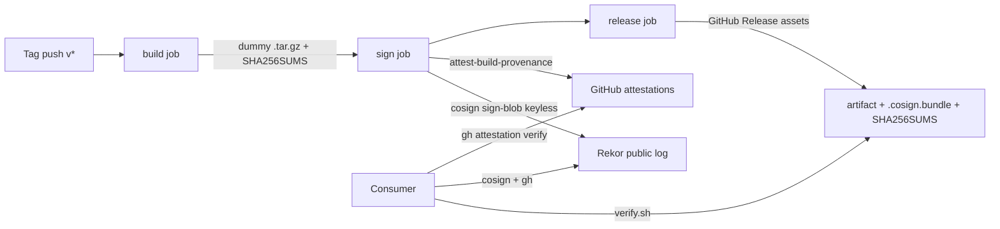

# signed-release

Reference **GitHub Actions release pipeline** that builds a tiny **dummy** artifact, signs it with **Sigstore keyless** (`cosign sign-blob` + GitHub OIDC), attaches **SLSA build provenance**, and publishes **SHA-256 checksums**.

Personal DevSecOps portfolio project. MIT licensed. No private payloads — the artifact is a hello-world tarball built from [`src/hello.sh`](src/hello.sh).

## Why a dummy artifact?

**Keyless signing in CI writes the repository name, the workflow identity, and the artifact digest to Sigstore's public [Rekor](https://docs.sigstore.dev/logging/overview/) transparency log.** Anyone can look up that digest later. That is why this repo only ever signs a disposable hello-world tarball — never secrets, never customer data, never anything you would not put on a public billboard.

## What it does



| Job | Permissions | Does |
| --- | --- | --- |
| `build` | `contents: read` | Checkout (`persist-credentials: false`), build dummy tarball, write `SHA256SUMS.txt`, upload artifact |
| `sign` | `contents: read`, `actions: read`, **`id-token: write`**, **`attestations: write`** | Download dist, `cosign sign-blob` (OIDC → Fulcio → **public Rekor**), `actions/attest-build-provenance` |
| `release` | **`contents: write`**, `actions: read` | On tag pushes only: publish the tarball, cosign bundle, and checksums as a GitHub Release |

Triggers: tag push `v*` and `workflow_dispatch` (build+sign always; GitHub Release only when `github.ref_type == 'tag'`). Every third-party action is pinned by **full commit SHA**. No `pull_request_target`.

OIDC subject shape for the signing identity:

```text
repo:dhivagar29/signed-release:ref:refs/tags/v*
```

Cosign certificate identity URI (what `verify.sh` pins):

```text
https://github.com/dhivagar29/signed-release/.github/workflows/release.yml@refs/tags/v…
```

## How to verify a release

Prerequisites on the consumer machine: `cosign`, `gh` (authenticated enough to read attestations), and this script.

```bash
# Download from the GitHub Release, then:
./scripts/verify.sh \
  --artifact signed-release-v0.1.0.tar.gz \
  --checksums SHA256SUMS.txt \
  --bundle signed-release-v0.1.0.tar.gz.cosign.bundle \
  --repo dhivagar29/signed-release
```

Checks, in order:

1. **SHA-256** of the artifact against `SHA256SUMS.txt`
2. **`cosign verify-blob`** with `--certificate-identity-regexp` pinned to this repo’s `release.yml` on a `v*` tag, and `--certificate-oidc-issuer https://token.actions.githubusercontent.com`
3. **`gh attestation verify`** for the SLSA provenance attestation

Sample (partly offline) output: [`docs/sample-verify.txt`](docs/sample-verify.txt).

### Local build (no signing)

```bash
./scripts/build-artifact.sh v0.0.0-local
# → dist/signed-release-v0.0.0-local.tar.gz + dist/SHA256SUMS.txt
```

Do **not** run `cosign sign-blob` in keyless mode on a laptop against this tree: that still talks to Fulcio/Rekor. Keyless signing belongs in the `sign` job only.

## Threat model

### What signing + provenance prove

- The blob’s digest was signed by a **Fulcio certificate** whose subject is this **workflow on a tag ref** in `dhivagar29/signed-release`, issued by GitHub’s OIDC (`token.actions.githubusercontent.com`).
- A **Rekor** entry exists for that digest + identity (public, append-only).
- GitHub recorded an **attestation** that this repo’s Actions run produced that subject (SLSA build provenance via `actions/attest-build-provenance`).
- The checksum file matches the artifact bytes you downloaded (integrity in transit / on disk).

### What they do not prove

- That the **source** was free of bugs or backdoors — only that the bits match what that workflow signed.
- That a **compromised `main` or a malicious workflow change** before the tag could not have altered the build. Pin workflow dependencies by SHA (done here) and review workflow diffs; signing does not replace code review.
- That **GitHub (or the runner)** was honest. Keyless trust anchors on the IdP and the transparency log, not on a long-lived offline key you hold.
- Confidentiality — Rekor is public. Digests and identities are visible. **Do not sign private artifacts with this pattern.**

## Limits

- Signs a **dummy** hello-world tarball only, by design (public Rekor).
- Keyless cosign in CI **always** contacts Fulcio/Rekor; there is no offline keyless mode.
- `release` publishes only on tag pushes (`v*`); `workflow_dispatch` builds and signs artifacts for inspection but does not create a GitHub Release.
- `verify.sh` requires `cosign` and `gh` on the consumer PATH; the offline test suite stubs them.
- Does not implement offline root-of-trust / TUF mirrors, cosign policy-controller, or binary authorization admission.
- Provenance is GitHub’s attestation store + SLSA predicate from `actions/attest-build-provenance`, not a custom in-toto layout.
- No container image signing (`cosign sign` for OCI); blob signing only.
- Repo is intended private until the owner makes it public; making it public and the first live tag that writes to Rekor are deliberate owner actions.

## Tests

```bash
shellcheck scripts/*.sh src/*.sh test/*.sh
actionlint
./test/verify.test.sh
```

## Licence

MIT — see [LICENSE](LICENSE).
